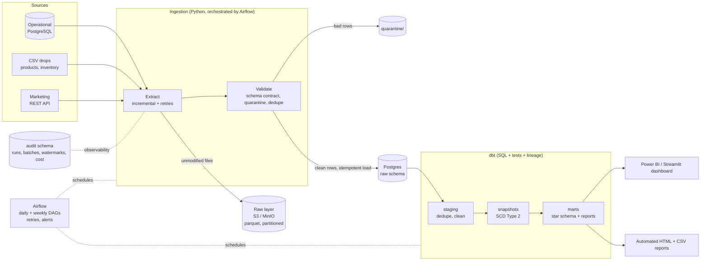

# Retail Data Platform: End-to-End Data Warehouse & Automated Reporting

A complete, runnable data platform that replaces "analysts download CSVs and build reports by hand" with an
automated, tested, observable pipeline: **sources -> ingestion -> raw layer (S3) -> dbt transformations -> star-schema warehouse -> reports & dashboards**.

   

## The business problem
An e-commerce company receives data from an operational Postgres database (customers, orders, items, payments),
CSV drops (product catalogue, daily inventory) and a marketing REST API. Reports were built manually from
downloaded files. This project automates the whole flow, handles dirty data safely, keeps history, and tells you when something breaks.

## Architecture



Details: [docs/ARCHITECTURE.md](docs/ARCHITECTURE.md) · [docs/DATA_MODEL.md](docs/DATA_MODEL.md) · [docs/DATA_QUALITY.md](docs/DATA_QUALITY.md) · [docs/RUNBOOK.md](docs/RUNBOOK.md) · [docs/POWERBI.md](docs/POWERBI.md)

## What is implemented

| Requirement | Implementation |
|---|---|
| Extract from multiple sources | Postgres (incremental SQL), CSV drops, REST API with retry/back-off (`src/retail_pipeline/extract.py`) |
| Reusable ETL/ELT pipelines | One generic `ingest_table` driven by declarative **data contracts** (`contracts.py`) + dbt ELT |
| Daily + weekly scheduling | `airflow/dags/retail_daily_pipeline.py`, `retail_weekly_pipeline.py` |
| Incremental loading | High-watermark per table + look-back window for late data |
| Duplicate / corrupted records | Validation quarantines bad rows (with reasons), dedupes by key; dbt re-dedupes in staging |
| Historical data | Append-only raw layer, SCD2 snapshots, weekly dated copies of reports (`marts_history`) |
| Fact & dimension tables, star schema | 5 facts, 3 dimensions in `dbt/models/marts` |
| Data-quality tests | 60 dbt tests (generic + singular) and 39 Python unit tests; failing tests stop downstream models |
| Lineage & documentation | dbt docs (`make dbt-docs`) with column descriptions and lineage graph |
| Reporting tables / daily revenue / sales & inventory | `rpt_daily_revenue`, `rpt_inventory_status`, `rpt_marketing_performance`, `rpt_product_performance` |
| Dashboards | Power BI model + DAX in [docs/POWERBI.md](docs/POWERBI.md) and a runnable Streamlit dashboard |
| Failure notifications, logging, retries | Slack/email alerts, JSON logs with run_id, task + HTTP retries with exponential back-off |
| Data freshness checks | `retail_pipeline freshness` + `dbt source freshness` |
| Idempotent execution | Re-running a date replaces its batch (same window, delete+insert in one transaction) |
| SCD Type 2 | `customers_snapshot`, `products_snapshot` -> `dim_customer`, `dim_product` with point-in-time joins |
| Automated schema validation | Missing columns fail the batch (schema drift); extra columns warn |
| Pipeline observability | `audit.pipeline_runs`, `audit.ingestion_batches`, dashboard "Pipeline health" tab |
| Cloud cost monitoring | `audit.cost_metrics` with storage/compute estimates and budget alert; Terraform lifecycle rules |
| Docker, CI/CD | `docker-compose.yml`, Dockerfiles, `.github/workflows/ci.yml` |

## Quick start (about 5 minutes)

Prerequisites: Python 3.10+, Docker.

```bash
git clone <your-repo-url> && cd retail-data-platform
python -m venv .venv && source .venv/bin/activate
make install
cp .env.example .env

make up                 # Postgres + MinIO (S3) + mock marketing API
make demo               # seeds 60 days of data, initial load, then 3 incremental days
make dashboard          # http://localhost:8501
make dbt-docs           # http://localhost:8081  (lineage graph)
```

`make demo` runs, for each day: **ingest -> dbt build (snapshots, models, tests) -> freshness check -> daily report -> cost metrics**.
Open `reports/daily_revenue_<date>.html`. A sample is in [docs/sample_output](docs/sample_output).

No Docker? Run Postgres yourself, set `STORAGE_BACKEND=local` in `.env`, and start the mock API with `make api` in a second terminal.

Run Airflow too: `docker compose up -d --build` then open http://localhost:8080 (user `admin`, password `admin`).
Set `SOURCE_HISTORY_START` in `.env` to the date printed by `make demo`'s seed step so the API/inventory first load starts from your data.

### Using real AWS instead of MinIO
Delete `S3_ENDPOINT_URL` in `.env`, set real AWS credentials, create the bucket with `infra/terraform` (`terraform apply -var bucket_name=<unique>`).
No code changes are needed, because boto3 talks to either.

## Project layout

```
airflow/dags/          daily + weekly DAGs (orchestration only)
src/retail_pipeline/   ingestion, validation, loading, audit, reports, cost, CLI, data simulator
dbt/                   staging, snapshots (SCD2), marts, tests, macros
sql/init/              schemas + audit tables
dashboard/app.py       Streamlit dashboard
docs/                  architecture, data model, quality, runbook, Power BI guide, sample outputs
infra/terraform/       S3 bucket with encryption, lifecycle rules, least-privilege IAM
tests/                 unit tests + integration test (Postgres)
```

## Design decisions (good interview material)
* **ELT with a validated raw layer.** Exact source files are kept in S3 (replayable), clean rows go to `raw`, dbt does the business logic.
* **Idempotency by design.** A batch id is `<table>__<logical_date>`; reruns reuse the same extract window and replace the batch atomically.
* **Look-back window.** Each run re-reads a few hours (marketing API: 3 days) before the watermark to catch late data. Duplicates are harmless because dedupe is deterministic (latest version wins).
* **Quality gates.** `dbt build` stops downstream models when an error-level test fails. Softer checks (e.g. payment-vs-order mismatches) use `severity: warn` and surface quarantine effects instead of hiding them.
* **Point-in-time dimensions.** Orders join to the customer/product version valid *at order time*, so margin uses the cost that applied then.
* **Privacy.** The customer dimension stores an email hash and domain, not the raw address.
* **Airflow isolation.** Airflow only schedules; work runs in a separate virtualenv via the CLI, so every task is reproducible locally.
* **Honest simulation.** Source data is synthetic (with intentional duplicates, negative amounts, malformed emails, `N/A` stock values, API failures) so you can *see* the safeguards work.

## Screenshots

### Sales


### Marketing


### Inventory


### Pipeline health, SCD2 and cost


## What was verified
The full flow (`make demo`: seed, initial load, 3 incremental days with SCD2 changes, `dbt build` with all tests, reports, freshness, cost, reconciliation),
the 39 unit tests, the 3 integration tests and the Streamlit app were run against PostgreSQL 16 with dbt-postgres 1.9+/pandas 3.
**Not run here:** the Docker Compose stack, Airflow itself (DAG files are syntax-checked), Terraform, GitHub Actions, and BigQuery/Redshift targets.
Expect to fix small environment-specific things on first run of those. Power BI cannot be shipped as code, so [docs/POWERBI.md](docs/POWERBI.md) gives the exact model, measures and layout.


