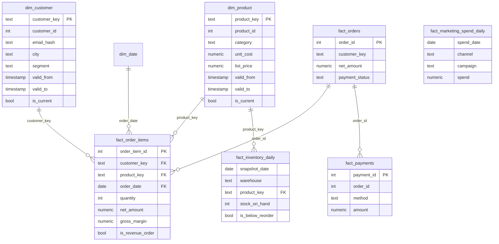

# Data model (star schema)

## Grain
| Table | Grain |
|---|---|
| `fact_order_items` | one order line |
| `fact_orders` | one order |
| `fact_payments` | one payment transaction |
| `fact_inventory_daily` | product x warehouse x day |
| `fact_marketing_spend_daily` | campaign x day |

## Business rules
* **Revenue** counts orders in `placed`, `shipped`, `delivered`. `cancelled` and `returned` are reported separately, so past days can be restated when a return happens.
* **Net amount** = quantity x unit price x (1 - discount). **Gross margin** = net amount - quantity x unit cost valid at order time.
* **Attribution** is last-touch: the channel on the order.
* **Unknown members**: a fact row whose customer or product is missing (e.g. quarantined) points to a `-1` "Unknown" dimension row instead of being dropped. `assert_orphan_rates_low` warns if more than 1% do.
* **SCD2**: the first version of every member is valid from 1900-01-01, so history before the first snapshot still resolves.

## Reporting tables
`rpt_daily_revenue` (7-day average, week-over-week), `rpt_inventory_status` (days of cover, stock status), `rpt_marketing_performance` (CTR, CPC, ROAS, cost per order), `rpt_product_performance`.
